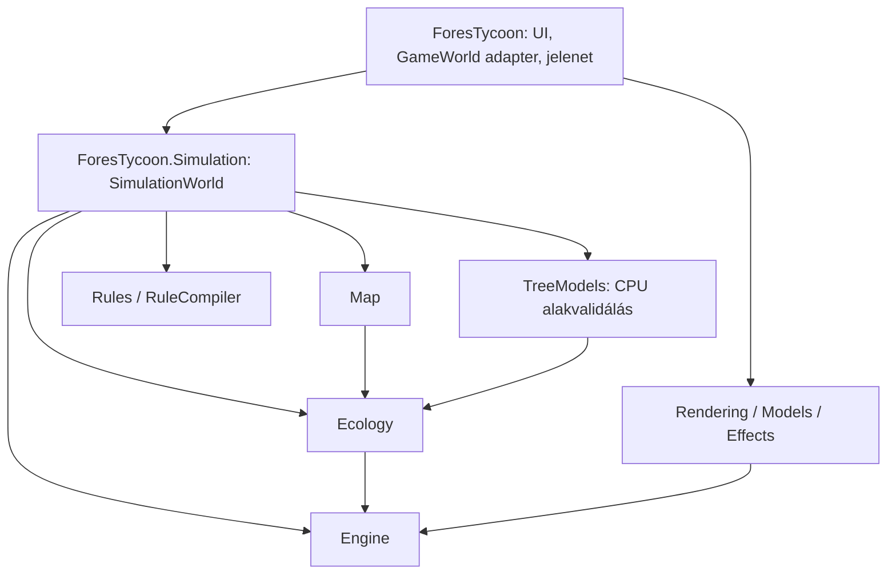

# Architektúra: rétegek és modulok, egyirányú függőség



A `Simulation` függőségi láncában nincs játék-, editor-, GPU-, ablak- vagy UI-modul.
Ezt a `SimulationModuleTests` tranzitívan, az `ArchitectureTests` a forrásokon is ellenőrzi.

| Szerelvény | Névtér | Felelőssége | Nem tudhat |
|---|---|---|---|
| `ForesTycoon.Engine` | `ForesTycoon.Engine` | `FixedStepClock`, `SimulationFrameRunner`, `IWorldSystem`/`WorldSystemCollection`, `BackgroundJobScheduler`, `AnimationTimeline`, `Vertex` | erdő, terep, GL |
| `ForesTycoon.Ecology` | `ForesTycoon.Ecology` | a természeti rendszer: időjárás, talaj, vízmérleg, fajok, erdőállomány és egyedek | terepháló, render, a játékvilág |
| `ForesTycoon.TreeModels` | `ForesTycoon.TreeModels` | fa- és cserjemodellek fajszinten: Arbaro-készlet → váz → háló | a világ, a render, a GL |
| `ForesTycoon.Map` | `ForesTycoon.Map` | a talaj mint adat és szabály: magasságrács, generálás, hidrológia, utak, szerkesztés, picking (`TerrainMap`); az erdő élőhelye (`IForestHabitat`) | GL, render, jármű, játékvilág |
| `ForesTycoon.Rendering` | `ForesTycoon.Rendering` | a render GPU-magja: `RenderDevice`, `GlProgram`, `RenderPipeline`/pass-ok, `VertexBuffer`, `DynamicPrimitiveBatch`, `DioramaPostProcess`, `RenderMetrics`, `ISurfaceVisuals` | erdő, terep, modellek, effektek |
| `ForesTycoon.Models` | `ForesTycoon.Models` | modellbetöltés és -rajzolás: `AnimatedGlbModel` (glTF/GLB), `AnimatedModelRenderer`, `ImportedSceneAsset` | járművek, erdő, terep |
| `ForesTycoon.Effects` | `ForesTycoon.Effects` | vizuális effektek: `WeatherRenderer`, `CloudRenderer`, `FogHabitat`, `WeatherVisualState` | terep, erdő (csak `IWeatherSurface`-en át látja a talajt) |
| `ForesTycoon.Simulation` | `ForesTycoon` (a meglévő belső típusnevek megőrzésével) | `SimulationWorld`, parancsok, logisztika, gazdaság, vadak, szabályfuttatás, mentés és akciójelző-állapot | render, ablak, UI, játékhost |
| `ForesTycoon` | `ForesTycoon` | `GameWorld` megjelenítési adapter, a terep jelenete (`Terrain`), jelenet-ragasztó, felület, diagnosztika | – |

A render-modulok a játékkal **interfészeken** csatlakoznak, amelyeket a játék valósít meg:
`IShadingSettings` / `IPostProcessSettings` / `IWeatherSettings` (a `GraphicsSettings` mindhármat),
`IWeatherSurface` (a `TerrainWeatherSurface` adja a terep- és lombkorona-magasságmezőt), `ISurfaceVisuals`
(a `SurfaceVisualRenderer`). Új modul így a játék ismerete nélkül tesztelhető.

## 1. Ecology – a szimulációs egység

Mappák: `Climate/` (időjárás, `WeatherPreset`), `Soil/` (`SoilProperties`), `Water/`
(`EnvironmentSystem`: lombkorona-, felszíni, talaj- és mélyvíz; `EcologyTime`; `IForestCanopy`,
`IForestEnvironment`), `Species/` (`ForestSpecies`, `ForestSpeciesProfile` ökológia,
`ForestSpeciesTraits` katalógus, növekedés, életfázisok, fenológia), `Forest/` (`ForestSystem`,
egyedek és versengés, telepítés, kitermelés, `IForestHabitat`), `Shape/` (`TreeShapeSpec` szerződés).

* **Belépési pont:** `Ecosystem`. Összeköti az erdőt és a víz/időjárás modellt, és a helyes többütemű sorrendben
  lépteti őket (víz → erdőhónap → összegzők törlése). A játék ezt példányosítja, nem a részeket.
* **A világhoz kötés:** csak `IForestHabitat` (csempék, nedvesség, magasság, talaj, szomszédság,
  kezdeti erdőminta). A `Terrain` ezt valósítja meg; tesztben bármilyen apró megvalósítás elég.
* **A két alrendszer egymás felé** interfészen át lát: az `EnvironmentSystem` a növényzetet az
  `IForestCanopy`-n át (interceptió, levélfelület, faj), az erdő a vizet és fényt az `IForestEnvironment`-en át
  (sugárzás, vízválasz). Így az időjárás- vagy vízmodell cserélhető anélkül, hogy az erdőhöz nyúlnánk.
* **Determinizmus:** csak seedből és időlépésekből számol, nincs óra, nincs GL – fejetlenül tesztelhető
  (`ArchitectureTests.EcosystemRunsHeadlessWithoutTerrainOrRendering`).

### Új fajt felvenni
1. `ForestSpecies` új érték (`Species/ForestSpecies.cs`).
2. Ökológia: egy sor a `ForestSpeciesProfile.For`-ban (kor, növekedés, nedvesség, magasság, árnyéktűrés, faanyag).
3. Katalógus: egy sor a `ForestSpeciesTraits`-ban (név, méretek, koronaarány, ráták, színek, shader-család).
4. Fenológia (ha lombhullató): naptár a `TreePhenology.For`-ban.
5. Modell: egy Arbaro-formátumú XML a `ForesTycoon.TreeModels/Architecture/Presets`-ben, a katalógus `Preset` mezőjével.
A UI-lista a `ForestSpeciesTraits.Playable`-ből épül. Tesztek (`ForestSpeciesCatalogTests`) minden fajt végigpróbálnak.

### Új időjárás-/vízmodell
Valósítsd meg az `IForestEnvironment`-et (és kapd az `IForestCanopy`-t); `Ecosystem.Attach` cseréli be.

## 2. TreeModels – fajszintű modellgenerálás

Bemenet: `TreeShapeSpec` (faj, mag, életfázis, méret, életerő, termőhely, lombállapot). Kimenet:
`DendroTreeGenerator.Generate(spec, lod)` → törzs/ág/korona csúcspontok, vagy `TreeShapeModel.Measure(spec)` →
`TreeShapeMetrics` (faanyag, alaktényező, koronamutatók).

* `Architecture/`: `TreeArchitecture` (Arbaro-készlet + életfázis/fény módosítók, váz-gyorsítótár),
  `TreeSkeleton` (topológiailag pontos váz, pipe-model vastagság, `Validate()`), `Presets/*.xml`.
* `Shape/`: `TreeForm` (feloldott forma: méretezés, torzítás, szín, életerő), `TreeShapeModel`.
* `Meshing/`: `TreeWoodMesh` (törzs, gyökér, ágak, csupasz ágrendszer), `DendroCrownMesh` (koronafelhő),
  `DendroTreeGenerator`, `ForestLod`.
* `TreeScale` az egyetlen hely, ahol a méter→világegység arány és a shader-anyagcsalád kódja él.
Részletek: [tree-shape-system.md](tree-shape-system.md), [arbaro-parameter-sets.md](arbaro-parameter-sets.md).

## 3. Rendering, Models, Effects – a render három modulja

* **Rendering (GPU-mag):** egyetlen helyen él a GL-állapot, a shaderfordítás, a kamera/modellmátrix, a pass-sorrend
  (`RenderLayer`, `RenderPipeline`), a puffer- és batch-kezelés és a kép utófeldolgozása. Más modul ide épít, ide nem ér vissza.
* **Models:** csak azt tudja, hogyan lesz fájlból rajzolható modell: glTF/GLB elemzés, csontváz-animáció mintavétel,
  anyag- és alfa-mód, árnyék- és kontúr-rajzolás. Az eszközkiválasztás (melyik fához melyik modell) a játék dolga.
* **Effects:** eső/hó részecskék, felhő, köd-szabályok és villám. Az akciójelzők időzített állapota
  a Simulation modulban, az `EffectRenderer` a játékban van. Az időjárás állapotát az Ecology-ból olvassa
  (`WeatherPreset`, `EnvironmentSystem`), a talajt az `IWeatherSurface`-en át.
Új effekt: egy új osztály az `Effects`-ben, a beállításai egy kis interfészen át; a játék köti be egy `RenderLayer`-re.

## 4. A játék – világ és megjelenítés

* `ForesTycoon.Simulation/World/`: `SimulationWorld`, parancsok és visszajátszható mentés, járművek,
  rönkszállítás, gazdaság és vadállomány. A `SimulationLoader.CreateProject` önálló, grafika nélküli világot készít.
* A játék `World/` mappájában a `GameWorld : SimulationWorld` megjelenítési adapter, a talajprofil
  színezése és a projektfájlokat figyelő `RuleProjectLink` marad. A host kezeli a `GraphicsSettings`, `Terrain`
  és `TerrainRenderer` erőforrásait. A szimuláció opcionális életciklus-hookokon át jelzi a pályacserét,
  az ellenőrzést és a felszabadítást; ezek az önálló világban nem végeznek grafikai munkát.
* A betöltés és generálás előbb külön jelölt világot épít, majd átadja az állapotot és a hozzá tartozó
  megjelenítést. Hiba esetén a régi világ megmarad. A mentésformátum és a fix időlépés változatlan.
* A modul a repository meglévő belső API-konvencióját követi (`InternalsVisibleTo` a hostnak, editornak
  és teszteknek); ez még nem verziózott, nyilvános csomag-API.
* `Terrain/Render` és `Terrain/Forest`: a terep **jelenete** (lásd az 5. pontot) – csak rajzol.
* `Rendering/Gpu` (beállítások, ImGui-vezérlő), `Rendering/Forest` (fa-GPU állapot, LOD, régi/importált fa-modellek),
  `Rendering/Models` (jármű-modell), `Rendering/Scene` (jelenet-rajzolók, amelyek a modulokat összekötik).
* A render csak olvas: `ForestSystem`-ből egyedeket, `TreeShapeSpec`-et épít (`TreeShapeSpec.From`), kéri a modellt, és
  feltölti. Soha nem módosítja a szimulációt. A fa újraépítése sávhatárhoz (`ShapeKey`) és fázis-/lombváltáshoz kötött.

### A szabálymotor felelősségei

A `ForesTycoon.Simulation/World` szabályfuttatója feladatonként tagolódik:

| Rész | Felelősség |
|---|---|
| `RuleScope.cs` | Típusos objektumhalmazok, mezők, műveletek és kapcsolatok szerződése. |
| `RuleEngine.Compilation.cs` | Kifejezések fordítása, olvasási tervek, hatások és áramlási slotok előkészítése. |
| `RuleEngine.cs` | A logikai lépés sorrendje, munkakerete és saját, újrahasznált `RuleWorkBuffers` pufferei. |
| `RuleNamedValues.cs` | Név szerinti bemenetek első olvasáskor rögzített értékei; élő előnézet és párhuzamos olvasás. |
| `RuleFlowLedger.cs` | Átadott mennyiségek összesítése és determinisztikus publikálása. |
| `RuleEngine.Flows.cs`, `RuleEngine.LocalFlows.cs` | Készletek közötti átadás; a saját cellás áramlások párhuzamos előkészítése. |
| `RuleEngine.Preview.cs` | A hatások magyarázata a futó lépés értékeinek módosítása nélkül. |
| `RuleEngine.State.cs` | Saját mezők, szabálykönyv és folyamatban levő lépés mentése, visszaállítása. |

A fordított leírások csak a szabály metaadatait és a kiértékelőket tartják; a módosuló bemeneti
és sajátmező-pufferek a futtatóhoz tartoznak. A kötött kiértékelők világonként, saját `RuleEngine`
példányban készülnek, a név szerinti bemenetek olvasójával együtt.

Egy logikai lépés egy névhez az első sikeres olvasás értékét használja. A közben kért előnézet
az élő világot olvassa, a mentés pedig a lépés már rögzített bemeneteit viszi tovább.
A párhuzamos áramlási lekérdezések ugyanazt az egyszer rögzített értéket kapják.
Az áramlási főkönyv minden munkarészlet után publikál; a fordítási slotok és a már publikált
kulcsok sorrendje megmarad. A korábban létező, időközben törölt áramlások összesítése is
megmarad a mentésben. A JSON-adatszerkezetek és a szabályok végrehajtási sorrendje változatlan.

A folyamatban levő szabálylépés visszaállítása az előkészített és eseményszűrt elemhalmazhoz
ellenőrzi a mentett kurzort. Az előkészítés és a számlálás is szeletelhető; hibás kurzor esetén
a jelölt világ betöltése megszakad, mielőtt átvenné a futó világ helyét.

Az áramlási előnézet a `Transfer` átadási számítást elkülönített készletmásolatokon futtatja.
Így a fogadó kapacitása és a szomszédok közötti elosztás is része az eredménynek;
a következő hatás az előző hatás módosított másolatát látja. Az élő készletek és a főkönyv változatlanok.

Az algoritmuscsomag és a rá mutató hivatkozás `BaseRevision` mezője az importáláskor használt
forrásalapot rögzíti. A forráshash a fájlokat stabil sorrendben, egységes sorvégekkel kezeli.
A szerkesztés és a klónozás megtartja ezt az eredetet. Megváltozott forrásalap esetén a korábbi
csomag automatikus indítása és újrafordítása is elutasításra kerül: a szerkesztéseket az új
forrásra kell átvezetni. A régi, eredetadat nélküli és a jelenlegi forrástól eltérő csomagokra
ugyanez vonatkozik; a tárolt gráffájlok megmaradnak.

## 5. A terep felelősségi köre: `ForesTycoon.Map` és a `Terrain` jelenet

A terep két, egyértelműen elkülönített dolog, nem egy osztály:

| | `TerrainMap` (`ForesTycoon.Map`) | `Terrain` (játék, `Terrain/Render`, `Terrain/Forest`) |
|---|---|---|
| Szerepe | a talaj **ténye és szabálya** | a talaj **megjelenítése** |
| Birtokolja | magasságrács (node/tile), hidrológia és nedvesség, úthálózat és a befagyasztott úttest-magasság, épületlábnyomok, a szerkesztő-kurzor, hover | csúcspont-pufferek, látható chunkok, víz-/út-/kellék-/erdő-/időjárás-rajzolás, útelőnézet |
| Műveletek | generálás, domborzat-szerkesztés (atomi, út- és épület-ellenőrzéssel), útépítés/bontás, útelhelyezés-elemzés, felszín-osztályozás (`TileSurface`: fű / földmű), sugár- és képernyőpont-keresés, felszíni magasság, élőhely-lekérdezések (vadállomány-helyek, halélőhelyek), az időjárás magasságmezője és határai | `UpdateVisibleTiles`, `Draw*`, GPU feltöltés |
| GL | **soha** (csak `OpenTK.Mathematics`) | igen |
| Függ | Engine, Ecology (ő az `IForestHabitat`) | a `TerrainMap`-től, nem fordítva |

A térképet a render **követi**, nem módosítja: `NodesChanged` (magasságok változtak),
`RoadDiagonalsChanged` (új kanyar-átlók), chunkonkénti `SurfaceVersion` (terep/rács), és `PropVersion`
(erdő/kellékek). A térkép globális `SurfaceVersion` értéke a felszín-osztályozás belső cache-ét kezeli,
nem érvényteleníti az összes GPU chunkot. Az `EditsFlushed` köteghatár-esemény megmaradt,
a korábbi teljes rácsbuffer-feltöltés megszűnt. A játéklogika (`GameWorld`, `ForestryLogistics`, `VehicleRoadRoute.Create`,
`Ecosystem`) a `TerrainMap`-et kapja; `Terrain.Map` adja a jelenet mögötti talajt. Így a terep szabályai
fejleszthetők és tesztelhetők (`TerrainMapTests`) kijelző nélkül, és a renderer cserélhető.

**Hova tegyek új dolgot?** Új terepszabály, mező, lekérdezés, szerkesztés → `TerrainMap`. Új vizuális
(szín, anyag, rajzolási sorrend, GPU-puffer) → `Terrain`. Ha a rajzolónak új tény kell, a térkép kapjon
egy lekérdezést vagy eseményt – a térkép sosem hív rajzolót.

## Adatfolyam egy fára

```
 ForestSystem (egyed: faj, kor, méret, egészség, erőforrások)
      │  TreeShapeSpec.From(tree, év, TreeSite)   ← ForestTreeSites: rés-irány, szél
      ▼
 TreeModels.DendroTreeGenerator.Generate(spec, LOD)  →  Vertex[] törzs / ág / korona
      ▼
 Terrain.ForestIndividuals: csempe-gyorsítótár, VBO-k, GPU-állapot (méret, egészség)
```

## Következő lépések
* A rajzoló részek (`Terrain/Render`, `Terrain/Forest`, `Rendering/Scene`) külön `ForesTycoon.Scene` szerelvénybe
  vihetők; a térkép-oldali szétválasztás ehhez már megvan.
* A szimuláció belső API-ja később szűk, nyilvános host API-vá alakítható.
* A `GlbTruckModel` és a fa-GPU állapot (`Rendering/Forest`) általánosítható és a `Models`-be vihető.
* Az `Ecosystem` mentés-pillanatképe (ellenőrzött snapshot + naplórészlet) a hosszú játékokhoz.

## Erdő-LOD: egyenletes megjelenés zoomolás közben
* Minden LOD ugyanazt a sziluettet tölti ki (`ForestLodConsistencyTests`): a durvább szintek a sokszög- és
  gyűrűhézag-veszteséget kompenzálják (`DendroCrownMesh.FillCompensation`), a Far szint 3 gyűrűt kap.
* A chunk-geometria szintenként gyorsítótárazott. Egy szint **soha nem látszik elavultan** egy friss helyett:
  `Terrain.ResolveForestLod` addig a chunk friss szintjét rajzolja, amíg a kívánt szint (évszak, méret,
  állomány) háttérben el nem készül, így nincs ugrás régi évszínre vagy régi fákra. Üresjáratban a szomszédos
  szinteket is előkészíti (`PrepareNeighbouringLods`).
