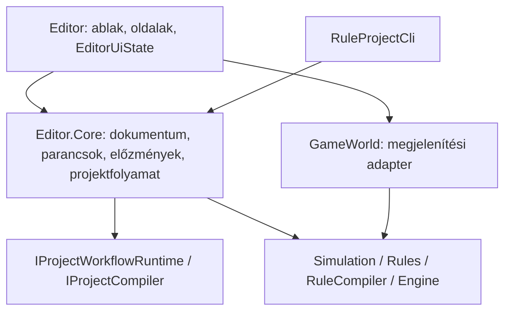

# Az Editor architektúrája

Az Editor szerkesztési állapotának egy tulajdonosa van: az `EditorDocument`.
A felület, a szimulációs próba és a fájlba írás külön felelősség. A parancssori
közzététel ugyanazt a projektfolyamatot használja, mint a grafikus szerkesztő.



## Projekt- és komponenshatárok

| Tulajdonos | Felelősség |
| --- | --- |
| `ForesTycoon.Editor.Core` | A munkadokumentum, annak önálló pillanatképei és revíziói; szerkesztési parancsok, előzmények, mentés és közzététel. Nem hivatkozhat a játékhostra, ImGui-ra, OpenGL-re vagy ablakkezelésre. |
| `RuleEditorView` | Komponensek összeállítása, ablakkeret, oldalváltás, projekt megnyitása/mentése és a háttérműveletek eredményének megjelenítése. |
| `EditorUiState` | Ablakonkénti kijelölések, szűrők, megnyitott fülek, térképecset és kameraválasztások. Nem kerül a projektfájlba és nem része a dokumentumrevíziónak. |
| `MapEditorView` | Rétegek, térképkijelölés, ecset-előnézet és építményelhelyezés. A kész ecsetvonás jelenetparancsot indít. |
| `SoilEditorView`, `SpeciesEditorView`, `BiomeEditorView`, `MissionEditorView` | A megfelelő típusok listája és űrlapja; a változtatásokat a jelenetparancsoknak adják át. |
| `TreeShapeEditorView` | Faalak- és színűrlapok, valamint az előnézethez tartozó CPU/GPU-erőforrások életciklusa. A beépített összehasonlítást külön fajadat-nézetből állítja elő. |
| `RuleWorkspaceView` | A külön szabályoldalak összeállítása, közös kiválasztás és az alkalmazási kérés továbbítása; az összefüggés-, folyamat-, vezérlő- és készletoldalak összehangolása. |
| `RuleBookView` | A szabálykönyv listája, csoportjai, hatásgráfja, ellenőrző űrlapja és számítási szerkesztője. |
| `RuleObjectBrowserView`, `RuleOverviewView` | Objektumhierarchia és mezők böngészése / mezőhasználat és több író megjelenítése; navigáció parancsokon és visszahívásokon keresztül. |
| `RuleLibraryView` | Sablontár és az aktív kötések felülete. A sablonok tárolását, átnevezését, importját és törlését a Core végzi. |
| `RuleFieldPickerView`, `RuleCurveEditorView`, `RuleCardWidgets` | Újrahasználható beviteli és megjelenítési elemek. Saját gesztus-/megjelenítési állapotuk van, a munkadokumentumhoz nem férnek hozzá. |
| `BehaviorEditorView`, `DynamicsEditorView` | Gráf-, vezérlő- és készletfelület; az adat és a helyi előzmény a Core megfelelő szerkesztési állapotában marad. |
| `CurrentRulesView` | A futó szabálykatalógus és rendszertérkép, továbbá a közös tuningprojekció. A jármű-munkaterületet külön komponensre delegálja. |
| `VehicleGeometryView` | Tengelyelrendezés, modellkötés, geometriai fogantyúk és járműpálya-próba. A változtatások ugyanazokat a tuningparancsokat használják. |
| `TrialEditorView` / Core `TrialService` | Próbabeállítások és eredményrajzolás / megszakítható CPU-próba, forrásrevízió- és térképméret-ellenőrzés. |

Az oldalak szűk kontextust kapnak (`EditorPageContext`, `RuleWorkspaceContext`,
`VehicleGeometryContext`), a fő nézetre mutató referencia nélkül. A világoldalaknak
jelenetparancs, a szabályoldalaknak szabálykönyv- és sablontár-szolgáltatás jár;
a kontextusok nem teszik elérhetővé az egész `EditorDocument` példányt.
A világoldalak `SceneSession`, a szabályoldalak `RuleBookSession`, a sablontár
`RuleLibrarySession` szolgáltatást kap. A nézetek ezekből kizárólag getteres
olvasóobjektumokat érnek el (`SceneView`, `RuleView`, a beágyazott hatások,
feltételek, fajok, talajok és más elemek nézetei). A listákon és szótárakon sincs
író művelet. A dinamika komponensen kívül a készletek és áramlások is ilyen
olvasónézetként látszanak; az egyenlet szerkesztési állapota a komponensen belül marad.

A szerializálható DTO-k a Core belső munkamodelljei maradtak. Egy ellenőrzött
`Edit` visszahívás kifejezetten szerkesztési hozzáférést ad a célhoz. A `Capture()`
módosítható, független másolatot ad; a számítási gráfok és a fajszínek lekérdezése
szintén másolatot szolgáltat. Ezek átírása nem változtatja meg a dokumentumot.
Az olvasónézetek nem pillanatképek: egy sikeres parancs után a meglévő nézet
ugyanannak az objektumnak az új értékeit mutatja. Undo vagy megnyitás által
lecserélt objektumhoz tartozó, illetve másik munkamenetből származó kijelölést
a parancsok elutasítanak.

A nézetek azonosságát gyenge referenciás gyorsítótár őrzi. A normál mező-, lista-
és szótárolvasás nem szerializálja a dokumentumot vagy a rögzített világot.
A mezőhasználat elemzése (`RuleFieldAnalysis`) a Core-ban történik, eredménye
csak olvasható, és a dokumentum verziójáig újra felhasználható. A mezőneveket,
egységeket, tartományokat és mondatokat a közös `RuleFieldCatalog` állítja elő.

## Szerkesztés és előzmények

Az `EditorSceneCommands` a pályaszerkesztés, a `RuleBookEditor` és a
`RuleInfluenceEditor` a szabályok, az `EditorAuthoringCommands` a sablontár
módosításainak belépési pontja. A gráf- és vezérlőparancsokat a
`BehaviorGraphEditor` / `BehaviorControllerEditor`, a készleteket és áramlásokat
a `DynamicsEditorState` kezeli. A nézetek nem indítanak saját, párhuzamos
előzménylistát.

Egy önálló jelenet- vagy szabályparancs saját tranzakciót zár le. Nyitott
szerkesztési gesztus esetén ugyanahhoz a tranzakcióhoz csatlakozik. Az egérhúzás
vagy aktív beviteli mező több képkockás szerkesztése így egy visszavonási lépés.
Mentés, oldalváltás és előzménynavigáció előtt a folyamatban lévő gesztus lezárul.
A kijelölés és a változatlan tranzakció megtartja a redo ágat. Az Undo a még
függő változtatást is rögzíti, ezért az Redo-val visszahozható.

A parancsok ellenőrzik a célobjektum tulajdonjogát: megnyitás vagy Undo előtti,
már lecserélt objektumhivatkozás nem írhat az új dokumentumba. Sikertelen,
részben végrehajtott tranzakció a kezdő pillanatképet állítja vissza.
A piszkozat köztes, javítandó állapotot is tartalmazhat; az alkalmazás és a mentés
ellenőrzése külön lépés, így a szerkesztés nem írja felül csendben a hibás kötést.

Az általános `EditorHistoryService<T>` adja a korlátos előzményt és a tranzakciós
életciklust. A dokumentumelőzmény a pályát, tuningot, szabálykönyvet,
viselkedéseket és dinamikát fogja össze. A sablontár külön helyi előzménnyel
rendelkezik; a pálya Undo-ja nem törli a sablonokat. A változatlan gráf saját
előzménye megmarad egy kizárólag térképet érintő visszaállításkor.
Az áramlás egyenletszerkesztője az áramlás tényleges gráfjához kötődik, és a
gráfgesztus a dinamika előzményében is egy lépés marad.

## Revíziók, alkalmazás és fájlműveletek

Az `EditorDocument.Capture()` független másolat; olvasás közben nem módosítja
a munkapéldányt. A teljes dokumentumrevízió az `Authoring` adatokat is tartalmazza.
Ez különbözik a futásidejű `ContentRevision()` azonosítótól. A jelenet mentettségét
a teljes, normalizált dokumentummal hasonlítjuk össze.

A `ProjectWorkflow` birtokolja az aktív fájlútvonalakat, mentési/közzétételi
szándékot és fordítási feladatot. A `ProjectPersistence` őrzi a fájlrevíziókat,
végzi az atomikus, archivált írást és a háttérben ellenőrzött jelenetmentést.
A háttérmunka indításkor készített másolattal dolgozik. Sikeres mentéskor a
mentett másolat revíziója lesz elmentettnek jelölve; egy közben folytatott
szerkesztés mentetlen marad. Sikertelen „mentés másként” nem cseréli le az aktív
útvonalat. Külső fájlváltoztatás ütközésként jelenik meg.

A grafikus host és a parancssor ugyanazt a `SimulationProjectWorkflowRuntime`
megvalósítást használja. A grafikus host a `GameWorld` példányt annak
`SimulationWorld` alaptípusán keresztül adja át; a Core a megjelenítési adaptert
nem ismeri. A `--publish-project`
ugyanazt a `ProjectWorkflow.Publish` folyamatot hívja meg, elvárt fájlrevízióval.
A CLI megőrzi a korábbi viselkedését: ellenőrzi a fordítást, és nem hoz létre
külön jelenetfájlt. A szerkesztői próba saját másolatából hagyja ki az algoritmus-
hivatkozást; az eredeti dokumentum és mentés megtartja azt.

A host a rejtett ablak mellett is pollolja az eredményeket. Leállításkor lezárja
a szerkesztést, megszakítja az át nem vett fordítást, befejezi az elfogadott
jelenetmentést és szükség esetén helyreállítási munkapéldányt ír.

## Bővítési szabály és ellenőrzés

Új szerkeszthető tulajdonságnál a modell a `Rules` projektben marad, a
tulajdonjog- és előzménykezelő parancs a Core-ba kerül, a beviteli mező pedig a
saját oldalnézetébe. A hozzá tartozó olvasónézetet is bővíteni kell; ezt a
`EditorReadModelTests.ReadModelsCoverAllPersistedPropertiesOfTheirDomainTypes`
teszt ellenőrzi. Új kijelölést vagy szűrőt az `EditorUiState` megfelelő
alcsoportjába kell tenni. Új háttérműveletnek induláskor saját másolatot kell
kapnia, és az eredményét a hostszálon kell átvenni.

Az `EditorCoreArchitectureTests` a Core tranzitív függőségeit és a kontextusokat
ellenőrzi. Az `EditorSceneCommandsTests`, a szabálykönyv-/hatás-/előzménytesztek
a tulajdonjogot, tranzakciókat, Undo/Redo-t és UI-állapot elkülönítését fedik le.
A `ProjectWorkflowTests` és `EditorMaintenanceTests` az aszinkron műveleteket,
hibakezelést és revíziókat vizsgálja. A natív próbák tényleges ImGui-bevitellel
ellenőrzik a gráfokat, görbéket, járműfogantyúkat és az ablak életciklusát.
Az `EditorReadModelTests` a beágyazott olvasófelületeket, másolatok függetlenségét,
az elavult és idegen kijelöléseket, a változatlan olvasások memóriaigényét és az
örökölt, hiányzó opcionális adatok mellékhatásmentes kezelését is ellenőrzi.

```powershell
dotnet build ForesTycoon.sln -c Release --artifacts-path artifacts/editor-readmodels/final --no-restore -warnaserror
dotnet test ForesTycoon.Tests/ForesTycoon.Tests.csproj -c Release --artifacts-path artifacts/editor-readmodels/final --no-build --no-restore
dotnet artifacts/editor-readmodels/final/bin/ForesTycoon.Editor/release/ForesTycoon.Editor.dll --smoke-test
dotnet artifacts/editor-readmodels/final/bin/ForesTycoon.Editor/release/ForesTycoon.Editor.dll --window-lifecycle-smoke-test
```

A korábbi TRX-riportok az `artifacts/editor-refactor`, az olvasófelületekhez tartozó
friss riportok az `artifacts/editor-readmodels`, a natív képernyőképek az
`artifacts/rule-editor` könyvtárba kerülnek. Ezek generált, Git által figyelmen
kívül hagyott ellenőrzési eredmények.

## Az 1–4. ütem lezárása, 2026-11-06

| Ütem | Elkészült eredmény | Ellenőrzés |
| --- | --- | --- |
| 1. Nézetek és UI-állapot | Külön világoldalak, szabály-munkaterület és járműgeometria-komponens; ablakonkénti `EditorUiState`. | Állapotizolációs teszt, natív editor- és önállóablak-próba. |
| 2. Önálló szerkesztési mag | `Editor.Core`, közös GUI/CLI projektfolyamat és szimulációs adapter; CPU-s próbafuttatás. | Tranzitív függőségi teszt, CLI-közzétételi teszt, CPU-/host-próbaeredmény-egyezés. |
| 3. Parancsok és tranzakciók | Jelenet-, szabály-, hatás-, tuning-, sablontár- és dinamikamódosítások a megfelelő Core-szolgáltatáson keresztül; közös előzménykezelés. | Tulajdonjog, részleges hiba visszaállítása, Undo/Redo, függő módosítás és változatlan gesztus regressziói. |
| 4. Végső ellenőrzés és leírás | Jelen dokumentum, kapcsolódó architektúra- és használati útmutató frissítése, teljes tesztfutás és natív próbák. | Az alábbi eredmények. |

- Release build `-warnaserror` kapcsolóval: 0 figyelmeztetés, 0 hiba.
- Teljes tesztcsomag: **1907 sikeres, 0 hibás, 0 kihagyott**;
  riport: `artifacts/editor-refactor/editor-complete-final.trx`.
- A végső Core/runtime-változás célzott ellenőrzése: **348/348**;
  riport: `artifacts/editor-refactor/editor-final-core-runtime.trx`.
- Natív editorpróba, önálló editorablak és többablakos életciklus: sikeres.
  A teljes futás közben lezárt, kizárólag a faelőnézet összehasonlítását érintő
  másolási optimalizálás külön, új builden és megismételt natív próbával ellenőrizve
  (`artifacts/editor-refactor/preview-verification`).
- `git diff --check`: tiszta.

A teherautó felmérési tesztje a repóban szállított GLB-t kifejezetten választja ki;
egy további teszt a renderer automatikus modellválasztását ellenőrzi. Így a helyi,
opcionális licencelt modell jelenléte nem változtatja meg a beépített modellre
vonatkozó teszt jelentését.


## A munkaterület és az olvasási határ további bontása, 2026-11-06

A `RuleWorkspaceView` az oldalválasztást és a közös komponensek összeállítását
végzi; a hozzá tartozó öt forrásfájl összesen 393 sor. A szabálykönyv
(`RuleBookView`), a sablontár (`RuleLibraryView`), az objektumböngésző
(`RuleObjectBrowserView`) és a mezőhasználat (`RuleOverviewView`) külön
példánnyal és szűk függőségekkel rendelkezik. A mezőválasztó, a görbeszerkesztő
és a szabálykártyák megosztott widgetjei saját komponensbe kerültek. A
mezőmetaadatok és a revízióhoz kötött mezőhasználati elemzés a Core része.

A világ-, szabály- és sablonoldalak `SceneSession`, `RuleBookSession` és
`RuleLibrarySession` felületen olvasnak. A kollekciók elemei és beágyazott
adatai is csak olvasható nézetek; a dinamikanézet készletei és áramlásai ugyanígy
érhetők el. A gráfok, görbék és exportálható minták kifejezett másolatai önállóan
módosíthatók. A dokumentum DTO-i továbbra is módosíthatók a szerializáláshoz és a
validált szerkesztési parancsokhoz; a normál nézetolvasás nem adja ki őket.

A gyenge referenciás azonosság-gyorsítótár megtartja a kijelölések azonosságát,
és nem tart életben törölt dokumentumokat. A parancsok elutasítják a másik
munkamenetből vagy korábbi dokumentumállapotból származó célobjektumokat.
Az olvasás nem másolja képkockánként a teljes dokumentumot vagy a világmentést,
és nem tölti ki a hiányzó opcionális modelladatokat.

Az új állapot ellenőrzése a `--artifacts-path artifacts/editor-readmodels/final`
kimeneten, egymást követő build és tesztindítással történt:

- Release build `-warnaserror` kapcsolóval: **0 figyelmeztetés, 0 hiba**.
- Az új olvasási szerződések célzott ellenőrzése: **16/16**;
  riport: `artifacts/editor-readmodels/readmodels-contracts-complete.trx`.
- Natív editorpróba és önálló szerkesztőablak: sikeres;
  napló: `artifacts/editor-readmodels/native-smoke.log`.
- Többablakos életciklus, UI-/kontextus-visszaállítás és hibás betöltés
  utáni takarítás: sikeres.
- Teljes tesztcsomag: **1923 sikeres, 0 hibás, 0 kihagyott**;
  riport: `artifacts/editor-readmodels/editor-readmodels-full.trx`.
- A szabálykönyv, a sablontár, a mezőhasználati nézet és az önálló ablak
  natív képernyőképeinek ellenőrzése: rendben.
- `git diff --check`: tiszta.
