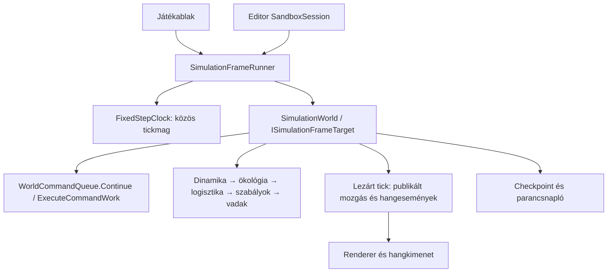

# Játékmotor: alapok felülvizsgálata és konszolidációja

Dátum: 2026-11-13. A vizsgálat kiterjedt az Engine, a Simulation és a játék
hostjának együttműködésére; nem csak az editorra. A meglévő réteghatárok
megtartása mellett tényleges végrehajtási kettőzéseket szüntettünk meg.

## Javított motorhibák és megszüntetett párhuzamos utak

| Terület | Korábbi probléma | Végleges megoldás |
| --- | --- | --- |
| Fix időléptetés | `Advance` és `AdvanceWork` külön tickciklust és számlálókezelést tartalmazott. | Egy `RunTicks` mag; az adapterek csak a hátralékkezelési politikát választják. Az interaktív út továbbra sem dob el játékidőt. A régi, korlátos szinkron adapter explicit kompatibilitási politika. |
| Hibás képkockaidő | A host előbb végrehajthatott parancsokat, és csak utána utasította el a NaN/hibás időadatot. | Közös bemenetellenőrzés minden módosítás előtt. |
| Ütemező állapota | A visszahívások újra beléphettek az éppen futó képkockába. A kooperatív tick közben másik adapter átvehette a számlálást. | Reentranciavédelem, `finally`-ban felszabadított hostreferenciák és tiltott félkész módváltás. A tickazonosító túlcsordulása nem futtathat újabb szimulációs lépést. |
| Host–motor kapcsolat | A játék és az editor képkockánként három delegáltat adott át, a runner további zárványt készített. | Egy `ISimulationFrameTarget` szerződés, ugyanaz a `SimulationWorld` adapter és egyszer létrehozott visszahívások. A runner nem ismeri a játékablakot vagy az editort. |
| Parancsvégrehajtás | Járműküldés, kitermelési kijelölés, építés és néhány szabálymódosítás közvetlen és szeletelt útja külön üzleti logikát / utófeldolgozást használt. | A közvetlen kompatibilitási belépések is az `ExecuteCommandWork` munkafolyamatot fogyasztják. Közös területképzés, készletpublikálás és előnézet-érvénytelenítés; törölt külön kitermelési algoritmus. |
| Parancssor | A már nem használt `WorldCommandQueue.ExecutePending` külön sorürítési ciklust tartott fenn. | Törölve; a sor egyetlen végrehajtója `Continue`. A világ szinkron API-ja ennek adaptere marad. |
| Szinkron világfrissítés | `Update` végtelenül pöröghetett, ha az előtérben folyamatban lévő generálás/parancs/export miatt a tick nem haladhatott. | Az adapter világos kivétellel visszautasítja a blokkoló előtérmunkát. A folytatható host továbbra is előbb azt fejezi be. |
| Világhatár | A közvetlen kompatibilitási parancsok félkész tickbe is beléphettek. | Közös határellenőrzés, fajkontextus és hibásvilág-kezelés az átvezetett parancsokhoz. |
| Generálási munkakeret | A belső munkafolyamat nem kapta meg a host megmaradt munkaegységkeretét. | A `MoveNext` a tényleges hátralévő keretet kapja; a kész világ publikálási határa változatlan. |

A közvetlen kompatibilitási parancs továbbra sem felhasználói naplóbejegyzés.
A páros összehasonlító teszt ezért külön ellenőrzi a 0/1 naplókurzort, majd az
összes többi checkpointmezőt teljes egészében összehasonlítja. Ez szándékos
belépési szemantika, nem külön játékszabály.

## Az áttekintett architektúra

| Vizsgált út | Megállapítás |
| --- | --- |
| Játék és editor szimulációja | Közös SimulationWorld, közös frame runner és közös időlépés. Nincs editoroldali fizikai vagy gazdasági másolat. |
| Járművek mozgása | A teherautó és erdészeti gép a közös RigPathFollower / VehicleKinematics modult használja. A teherautó hosszmenti erő-/üzemanyagmodellje és a munkagépek szabályvezérelt munkasebessége eltérő feladat, nem felcserélhető algoritmus. A fizikai útvonal nélküli konstans sebességű fixture ugyanahhoz a kinematikához csatlakozik. |
| Szabályok és anyagkönyvelés | Közös RuleProject és szimulációs szabályfuttató. A renderer nem vesz át készletkönyvelést, és az animáció letiltása nem változtatja az anyagátadást. |
| Mentés és világcsere | A Load izolált jelöltet állít elő, validál/visszajátszik, majd Adopt lépésben publikál. A generálás ugyanehhez a tulajdonosváltáshoz csatlakozik. Hibás parancs utáni újragenerálás, megszakítás és mentési egyenértékűség meglévő regressziói megmaradnak. |
| Háttérmunka | A korlátos tiszta lekérdezés és az aszinkron előkészítési feladat eltérő publikálási életciklust igényel. Ezeket nem vontuk össze olyan általános schedulerbe, amely elmosná a determinisztikus sorrendet vagy a tulajdonosi szálat. |
| Függőségi határok | Engine/Simulation/Editor.Core továbbra sem függhet natív grafikától, ablakrendszertől, UI-tól vagy OpenAL-tól; ezt az architektúratesztek ellenőrzik. |

## Mérés és regresszió

- `EngineConsolidationTests`: közös tickelszámolás, nagy szinkron tickkeret,
  hibás input előtti változatlanság, reentrancia, félkész módváltás,
  túlcsordulás, közvetlen/sorolt parancsok teljes állapotegyezése,
  félkész tick védelme és előtérmunka miatti szinkron végtelenciklus megelőzése.
- A frame runner 1000 bemelegített, interaktív szerződésű frissítése
  **0 menedzselt bájtot** foglal a tesztben. Ez az ütemező saját költsége;
  nem állítás a teljes világfrissítés allokációmentességéről.
- A 128×128 és 256×256 pályán futó parancs-/útvonalbenchmark teljes és
  szeletelt állapota, illetve útvonala pontosan egyezik. A 64 egységes
  parancsszeletek legnagyobb mért ideje 0,254 / 0,093 ms; a gyorsítótárazott
  előnézeté 0,578 / 0,107 ms. Rövid szintetikus mérés más tesztek mellett;
  nem reprezentatív teljesjáték-p99 vagy általános gyorsulási arány.
- A 114 célzott motor-, perzisztencia-, óra-, parancs-, audio- és
  architektúrateszt sikeres. A natív játék/előnézet/editor életcikluspróba
  az új közös hostszerződéssel is átment.
- A teljes Release tesztcsomag részletes naplózású ellenőrzése:
  **1960/1960 sikeres**, 5,11 perc (`detailed.trx`). A net8.0 célkeretrendszerű
  tesztek a telepített .NET 10 futtatón, roll-forward beállítással futottak.
- Az ezt megelőző teljes futás 625 sikeres eset után nem haladt tovább;
  több mint tíz perc után megszakítottuk. Ez **megszakított**, nem sikeres
  ellenőrzés (`complete.trx`, `full-tests.log`). A hívásverem-diagnosztika
  nem azonosította az okot; a sikeres újrafuttatás önmagában nem bizonyítja
  az időszakos elakadás megszűnését.
- A normál naplózású, automatikus elakadásfigyeléssel megismételt teljes
  futás szintén **1960/1960 sikeres, 0 kihagyott**, 4 perc 6 másodperc
  (`repeat.trx`, `repeat-tests.log`). Az elakadás a két ellenőrző futásban
  nem ismétlődött meg; kiváltó oka továbbra sem ismert.

Generált bizonyítékok: `artifacts/engine-consolidation/`.
A térbeli hangok és az animációesemények külön ellenőrzési csomagja:
[megjelenítés és hang konszolidációja](consolidation-2026-11-13.md).

## További fejlesztések szabályai és határai

Új játékfunkció egyetlen szimulációs implementációhoz csatlakozzon, verziózott
projektadatot és szükség esetén mentési migrációt kapjon. A direkt/headless API
adapter lehet, külön szabályalgoritmus nem. Új host a közös frame-szerződést
használja; új renderer csak publikált állapotot olvasson.

Ez az ellenőrzés a motor kritikus végrehajtási és tulajdonosi útvonalait
vizsgálta. Nem bizonyítja a teljes kódbázis minden ágának szükségességét vagy
minden hardveren a hibamentességet. A nagy szabályentitás-, géplogisztika- és
HUD-fájlok további felelősség szerinti bontása indokolt, ha konkrét funkció
változtatása megköveteli. A több hónapos szimulációs stresszteszt, valós pályák
terhelésprofilja, ökológiai kalibrálás és Windows/Linux natív eszköztesztek
külön munkák; ezeket a mostani eredmények nem helyettesítik.

Folytatás: a hosszú szimulációs próbát és a tesztelakadás vizsgálatát a
[stabilitási jelentés](stability-stress-2026-11-13.md) dokumentálja. Ennek
eredménye a közös háttérfeladat-várakozás javítása, valamint a malom és az
összesített kiszállítás kettős pontosságú könyvelése. A fenti, még ismeretlen
elakadásra vonatkozó megállapítás az első ellenőrzés történeti állapota.
