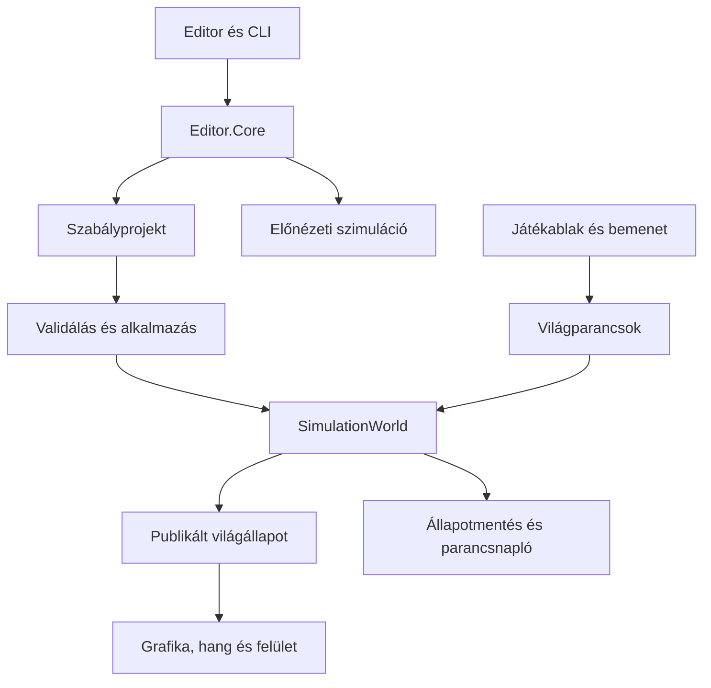

# A ForesTycoon fejlesztési platform architekturális terve

**Kiindulópont** `main` · `c54425b` · 2026. november 14.

A platform akkor használható napi játékfejlesztésre, ha egy új szabályt, pályaműveletet vagy játékmechanikát ismert helyen lehet megvalósítani, az editorban kipróbálni, a játékba átadni, majd mentés után reprodukálni. Ehhez a meglévő moduláris C#-szerkezetet érdemes megerősíteni. A közös szimulációs mag, a natív grafikától független `Editor.Core`, a fix időlépés és az elkülönített világjelöltre épülő betöltés már rendelkezésre áll.

## Jelenlegi állapot és prioritások

| Sorrend | Megfigyelés a jelenlegi kódban | Következmény |
| --- | --- | --- |
| 1 | A `ProjectPersistence` zára példányon belüli. A fájlrevízió ellenőrzését követően külön művelet a fájlcsere. A játék `RuleProjectLink` kódja bizonyos esetekben közvetlenül írja ugyanazt a projektfájlt. | Az egy időben mentő editor, CLI és játék műveletei között elveszhet egy módosítás. [ProjectPersistence](../ForesTycoon.Editor.Core/ProjectPersistence.cs#L82), [RuleProjectLink](../ForesTycoon/World/RuleProjectLink.cs#L68), [RuleProject](../ForesTycoon.Rules/RuleProject.cs#L82) |
| 2 | A szabályprojekt fájljának mentése, a parancs sorba állítása és az alkalmazás külön időpont. Az editor az élő objektumkatalógus frissességéből következtet az átvételre. Pályaépítéskor az előnézeti pályakulcs már a kérésnél frissül. | A felületen a közzététel, a tényleges alkalmazás és a sikertelen előnézet állapota nem minden esetben követhető egyértelműen. [RuleProjectLink](../ForesTycoon/World/RuleProjectLink.cs#L120), [Workshop](../ForesTycoon.Editor/RuleEditorView.Workshop.cs#L22), [Editor világ](../ForesTycoon.Editor/RuleEditorView.World.cs#L58) |
| 3 | Egyedi algoritmusgráfnál a natív utódablak `ready` fájlt ír a grafikus előkészítés befejezésekor, a közzétett projekt első pollolása előtt. A meglévő integrációs teszt grafika nélküli utódot indít, amely már ténylegesen alkalmazta a projektet, amikor nyugtáz. | A két belépési pont eltérő feltétellel jelzi az átadás sikerét. A natív átadásnál a régi játék bezárása előrébb kerülhet, mint az új szabályrevízió igazolt alkalmazása. [Natív indítás](../ForesTycoon/App/Viewport.Loading.cs#L37), [Folyamatátadás](../ForesTycoon/World/RuleProjectLink.cs#L45), [Integrációs teszt](../ForesTycoon.Tests/AlgorithmGraphTests.cs#L98) |
| 4 | Az `Editor.Core` réteghatára teszttel védett. A grafikus editor nézetei közül több közvetlenül a `GameWorld`-öt használja. A `SimulationWorld` virtuális megjelenítési műveleteket hív, a `GameWorld` örökléssel kapcsolja hozzá a renderelést. | Az ökológia és szabályok önállóan futtathatók. Az editoroldalak, a világcsere és a grafikus erőforrások életciklusa még szorosabban összekapcsolódik a szükségesnél. [EditorPageContext](../ForesTycoon.Editor/EditorPageContext.cs#L5), [SimulationWorld host](../ForesTycoon.Simulation/World/SimulationWorld.Host.cs#L10), [GameWorld](../ForesTycoon/World/GameWorld.cs#L7) |
| 5 | A tick sorrendje egy megállítható iterátorban, részben számozott profilozási fázisokban él. A gyorsmentés és gyorsbetöltés szinkron fájlműveletet és állapotfeldolgozást végez az ablak útvonalán. | A sorrend játékszabályt is hordoz. Nagy mentésnél az ablak késleltetése külön mérendő, és az állapot leválasztása szükséges a háttérben történő íráshoz. [Tick](../ForesTycoon.Simulation/World/SimulationWorld.cs#L250), [Gyorsmentés](../ForesTycoon/App/Viewport.cs#L483) |
| 6 | A GitHub automatikus ellenőrzése Windows és Ubuntu grafika nélküli futást indít. A Windows natív ellenőrzés kézi, kötött hardverű feladat. A `large-world-performance.md` egyik része még automatikus Linux natív próbát ír le. | A natív működésről és a teljesítményről külön, a tényleges platformon futtatott eredményt kell nyilvántartani. [Automatikus CI](../.github/workflows/engine-validation.yml), [Hardveres CI](../.github/workflows/engine-hardware-validation.yml), [Teljesítményútmutató](large-world-performance.md) |

## Célarchitektúra

| Felelős réteg | Tulajdonolt állapot és a fejlesztő belépési pontja |
| --- | --- |
| `Engine` | Fix óra, keret szerinti végrehajtás, háttérmunka és általános munkaszeletek. A játékmechanika szabályai a szimulációs rétegben kapnak helyet. |
| `Simulation`, `Ecology`, `Map` | A futó világ, az állapotot módosító parancsok, a determinisztikus sorrend és az invariánsok. Az ökológiai vagy térképi algoritmus elsődleges helye a saját meglévő modulja. |
| `Rules` | A verziózott `RuleProject`, szabálykönyv, tuning, döntési gráf és megjelenítési kötések. Egy új szerkeszthető játékértékhez stabil azonosító, mértékegység, tartomány és alapérték tartozik. |
| `Editor.Core` | Szerkesztői munkapéldány, parancsok, Undo/Redo, olvasómodellek és közzétételi folyamat. Az előnézet saját világpéldányt léptet a közös szimulációval. |
| Játék és editor grafikus felülete | Beviteli események, kamera, natív ablak, grafika és hang. A nézet parancsot kezdeményez, és a szükséges állapotot olvassa. A renderelés például láthatja a jármű elkészült mozgásmintáját, a készletmozgást a szimuláció könyveli. |
| `RuleCompiler` és futtatóátadás | A teljes algoritmusgráf fordítási és futtatóváltási útja. A tuning, a szabálykönyv és a deklaratív gráf a meglévő futtatóban, lezárt ticknél alkalmazható. |

Az első körben elegendők a meglévő projektek. Új könyvtárat csak akkor érdemes létrehozni, ha egy már kipróbált határhoz konkrétan szükséges új függőségi irány. A játék és az editor közös renderkódja a jelenlegi helyén használható, amíg a térképoldalon az olvasási és műveleti határ meg nem szilárdul.

## Végrehajtási ütemek

### 0. Referencia és megismételhető ellenőrzés

- Rögzítsd ugyanarra a Git-revízióra a Release buildet, a szabálykatalógus-ellenőrzést, a teljes grafika nélküli tesztfutást és az editor–játék natív életcikluspróbáját. Legyen a napló része a tényleges .NET-futtató, az operációs rendszer és az architektúra. A repo ellenőrző belépése a `tools/verify-engine.ps1`, natív futtatáshoz a `-Native` kapcsolóval.
- Tarts fenn három referenciát a meglévő tesztekre építve. Az indulópálya adja a valós játékfolyamatot, az esős fuvarozás a szabályok és anyagmérleg összevetését, egy korábbi mentés pedig a kompatibilitást. A tiszta Windows teljesítményfutás külön mérés a meglévő RTX 5060 profillal. A macOS-t saját natív futás alapján értékeld.
- **Kész**, ha a futások az adott revízióra visszakereshetők, és a reprodukcióban egyértelmű a meglévő ismert eltérés és a környezeti hiba. A mentési és közzétételi regressziók javítása közben is folytatható a natív referencia felvétele.

### 1. Mentés, közzététel és visszajelzés

**Helyi állapot, 2026. november 14.** Az editor, a CLI és a játék közös projektírása revízióellenőrzést, folyamatok közötti fájlzárat és atomi fájlcserét használ. A párhuzamos CLI-próbában egy közzététel sikerült, a versengő író hibával tért vissza, és az archívum bájtra pontosan őrizte az eredeti fájlt. A mentési változtatás 65 célzott regressziós tesztje sikeres.

A futó játék a szabályparancs befejezése után visszaigazolja az alkalmazott revíziót és a tick számát. Az editor külön, verziózott státuszfájlból olvassa ezt. A hozzá tartozó 52 célzott teszt sikeres, beleértve a részben végrehajtott parancsot, a hibás közzétételt és a pályacsere utáni visszaigazolás törlését.

Az editor az előnézetet akkor jelzi naprakésznek, amikor az adott kérés pályája elkészült és ténylegesen ez a pálya fut. Megszakítás, hiba vagy világcsere után a státusz ezt követi. Futtatóváltáskor az utód rögzített projektfájlt és világmentést kap. A szülő az egyező projekt- és algoritmusrevíziót, valamint a tick számát ellenőrzi bezárás előtt. A grafika nélküli integrációs próba az átadás alatt megjelenő új közzétételt is gyakorolja. A natív OpenGL-próba a helyi környezetben nem jutott el a nyugtáig, ezért a grafikus átadás ellenőrzése még nyitott. A fordítási gyorsítótár helyi ellenőrzéshez a `FORESTYCOON_ALGORITHM_CACHE` változóval átirányítható.

1. Tedd közössé a revíziófeltételes írást ott, ahol a játék, az editor és a CLI egyaránt eléri. Célútvonalanként egy, folyamatok között is érvényes zárolás alatt történjen a revízióellenőrzés, az archiválás és az atomi fájlcsere. A játék projektfájlt létrehozó vagy kiegészítő műveletei is használják ezt az utat. Az algoritmusfordítóban már van fájlzáras precedens. Az idegen szövegszerkesztők saját fájlírása ettől független, ezért az ütközéskezelés garanciáját a közös írókra fogalmazd meg. [A meglévő fordítási zárolás](../ForesTycoon.RuleCompiler/AlgorithmBuild.cs#L102)
2. Külön állapotként jelenjen meg a piszkozat mentése, a közzétett revízió, az előnézet készültsége és a futó játék alkalmazott revíziója. A játék nyugtája tartalmazza a világ vagy munkamenet azonosítóját, a projekt és az algoritmus revízióját, a lezárt tick számát és az eredményt. A státusz legyen kis üzenet, független a részletes világkatalógus exportjától. Az editor pályaépítési állapota a tényleges sikerhez kapcsolódjon.
3. Dokumentáld és teszteld a műveleti határt. A szabály, tuning és megjelenítési kötés alkalmazható futó világon. A domborzatot és a kezdőállapotot újraépítő módosításnál legyen explicit világcsere. A jelenetmentés és az előnézeti alkalmazás saját eredménye a `ProjectWorkflow` meglévő szemantikáját kövesse. [Meglévő közzétételi eredmények](../ForesTycoon.Editor.Core/ProjectWorkflow.cs#L149)
4. Az algoritmusgráf utódfolyamata pontosan az átadáshoz rögzített revíziót töltse. A korábbi folyamat akkor zárjon, amikor az utód ellenőrizhetően ugyanazt a világot visszaállította, a célprojektet alkalmazta, és a host használható. Sikertelen vagy lejárt átadásnál a korábbi világ folytatható.

**Kész**, ha két versengő író közül csak az egyik mentheti azonos alaprevízióval a változását, az editor jelzi az ütközést, és a korábbi tartalom archiválható. Átment a késve elkészülő előnézet, a hibás pályaépítés, a hibás szabály, a leálló utódfolyamat és az átadás közben megjelenő új publikáció esete. A natív és fej nélküli nyugta ugyanazt az alkalmazási feltételt jelenti.

### 2. A szimulációs határok rögzítése

**Helyi állapot, 2026. november 14.** A tick és a profilozás ugyanazokat a nevesített fázisokat használja. A munkagépek forgalmi eseményeit az idővezérelt szabályok előtt, a teherautókét a kész állapot publikálása előtt dolgozza fel a motor. Regressziós teszt ellenőrzi az eltérő sorrendből adódó útkopást és a tick közben kért mentésből visszaállított állapotot. A járművek útvonalai betöltés után az átvett térképet használják. Az esős fuvarozási diagnosztika 148 soros CSV-kimenete az átalakítás előtt és után bájtra egyezik.

A helyi, grafika nélküli mentési próba három mért futásának mediánjai, egy bemelegítő futás után. A szerializálás memóriába történt, a lemezírás a külön mért atomi fájlírást és flush-t tartalmazta. Az eredmények tájékoztató jellegűek.

| Pálya | Állapot rögzítése | Szerializálás | Lemezírás | Teljes betöltés | Fájlméret |
| --- | ---: | ---: | ---: | ---: | ---: |
| 16 × 16 | 8,9 ms | 94,9 ms | 6,9 ms | 707,0 ms | 3,2 MB |
| 64 × 64 | 13,9 ms | 92,9 ms | 25,5 ms | 514,1 ms | 30,9 MB |
| 128 × 128 | 38,6 ms | 237,5 ms | 76,2 ms | 1 050,0 ms | 126,4 MB |

A gyorsmentés tickhatáron rögzíti az állapotot, a szerializálás és az atomi írás háttérben fut. Egyszerre egy gyorsmentés fut, a játék bezáráskor megvárja a megkezdett írást. A gyorsbetöltés továbbra is elkülönített világjelöltet készít, szinkron úton. A natív felületen a késleltetés újramérése még hátravan.

- A meglévő `UpdateWork` tényleges sorrendjét rögzítsd nevesített fázisokkal és kis tesztekkel. A forgalmi események feldolgozása két ponton fut. Előbb a keletkezési helyeket és a sorrend okát ellenőrizd, majd védd regresszióval. A fázisszámlálás és a profilozási név ugyanazt a fázist azonosítsa. Az átállás első változtatása őrizze meg a végrehajtási sorrendet.
- Új és átalakított játékparancsnál egy végrehajtási út szolgálja ki a játékot, a fej nélküli próbát és a napló visszajátszását. A perzisztált `WorldCommandRecord` maradjon kompatibilis. Egy dokumentált parancsmintán ellenőrizd a normál játékbemenetet, a soros és szeletelt végrehajtást, valamint a mentés utáni folytatást. [Parancsvégrehajtás](../ForesTycoon.Simulation/World/SimulationWorld.CommandWork.cs#L23), [Szeletelt futás tesztjei](../ForesTycoon.Tests/SimulationWorkTests.cs)
- A világcsere állapotát csak elkészült jelöltből publikáld. A meglévő `Adopt` átkötéseit egyetlen alrendszeren, például az útvonal-lekérdezéseken keresztül egyszerűsítsd. Legyen teszt arra, hogy világcsere után nincs callback a korábbi térképre. A háttérmunka saját vagy leválasztott adaton dolgozzon, a megjelenítés a tulajdonosi szálon vegye át az eredményt. [Világcsere](../ForesTycoon.Simulation/World/SimulationWorld.cs#L524)
- Mérd külön az állapotkivétel, a szerializálás, a lemezírás és a betöltés költségét. Elsőként a leválasztott állapot szerializálását és a fájlírást mozgasd háttérbe, ha a mérés ezt indokolja. A betöltés továbbra is elkülönített jelöltet készítsen. Régi mentésnél külön teszteset az importálható checkpoint és a régi futtatóhoz kötött visszajátszás. [Mentési szerződés](../ForesTycoon.Simulation/World/Persistence/WorldSaveData.cs#L74)

**Kész**, ha azonos buildben és azonos futtatón a szinkron, szeletelt és visszatöltött referenciaállapot egyezik a kijelölt tickeken. Platformok között a pontos eseménysorrend és az invariánsok mellett indokolt toleranciával vizsgáld a lebegőpontos mezőket. A félkész tickből kezdeményezett mentés elkészült állapotot kap, a hibás betöltés pedig meghagyja a régi világot és a sorban váró parancsait.

### 3. Editor és megjelenítés határainak szűkítése

- Vezesd át a térképoldalt a meglévő Core-os olvasómodellekre és szerkesztési parancsokra. A nézet csak a csempe- és kijelölési lekérdezéseket, az ecsetműveleteket és az előnézet állapotát kapja. Ezen az oldalon a teszt ellenőrizze, hogy a közvetlen `GameWorld` paraméter és a módosítható dokumentum elérése megszűnt. [Térképoldal](../ForesTycoon.Editor/MapEditorView.cs), [Core térképparancsok](../ForesTycoon.Editor.Core/EditorSceneCommands.Map.cs)
- A megjelenítési oldalon válassz egy már tickhatáron átadott adatutat, például a jármű mozgását vagy géphangját. A megjelenítés ebből olvasson, és az aktív játékablak legyen a GPU- vagy audioerőforrások tulajdonosa. A teljes terep állandó másolása helyett csak a fogyasztó által igényelt olvasóállapotot terjeszd ki. Az öröklés felől összetételre csak a következő, ténylegesen leválasztott adatutak ismeretében érdemes átállni. [Mozgásminták átadása](../ForesTycoon.Simulation/World/SimulationWorld.cs#L275), [Natív ablak életciklusa](../ForesTycoon/App/RenderGameWindow.cs#L38)
- Tartsd meg a meglévő architektúrateszteket. A térképoldal után a következő modult a ténylegesen fejlesztett játékfunkció válassza ki. Az `InternalsVisibleTo` hozzáféréseket fogyasztónként akkor szűkítsd, amikor az új olvasási vagy műveleti határt már használják.

**Kész**, ha egy térképművelet előnézete, Undo/Redo-ja, mentése és futó játékbeli hatása végigtesztelhető, miközben a térképoldal elszigetelten tesztelhető a teljes játékvilág nélkül. A játék és az editor natív ablakának bezárása és újranyitása is átmegy a meglévő életcikluspróbán.

### 4. Egy valódi játékfunkció a platform próbájaként

Javasolt első funkció a **fuvarozási esőpolitika** szerkesztése és használata. A meglévő `--rain-haulage-scenario` három döntést már összehasonlít, de a diagnosztika közvetlenül időzíti a jármű hozzárendelését. Ettől jól körülhatárolható a következő fejlesztés. [RainHaulageScenario](../ForesTycoon/Diagnostics/RainHaulageScenario.cs#L41)

| Útvonal | Elfogadási feltétel |
| --- | --- |
| Adat → editor | A politika a meglévő logisztikai szabály- vagy konfigurációs modellen keresztül kap stabil azonosítót és dokumentált alapértéket. A korábbi projektek a megszokott működéssel nyílnak meg. A módosítás visszavonható. |
| Editor → előnézet | Ugyanaz a kiinduló mentés, időjárás és időtáv használható az alap- és módosított próbában. A próba a tényleges játékszabályt futtatja, és megmutatja az indulás idejét, az útkopást és a szállított mennyiséget. |
| Előnézet → játék | Közzététel után a futó játék az alkalmazott revíziót nyugtázza. A politika tényleges játékmenetben befolyásolja a hozzárendelést vagy az indulást. |
| Játék → mentés | A döntés utáni mentésből ugyanaz a soron következő esemény és a megfelelő készlet folytatódik. A feladás, fuvarozás és leszállítás során a faanyag mérlege megmarad. |

Már a 2. ütem után készülhet új játéklogika a közös szimulációs útvonalon. A 3. ütemben annyi nézetet és megjelenítési adatutat kell átvezetni, amennyit az első valódi funkció és a térképszerkesztő megkíván. Az ütemek külön, önállóan ellenőrizhető változtatásokban kerülhetnek a `main` ágra.

## Döntések a későbbi fejlesztéshez

- **Játékszabály vagy motorinvariáns.** Ár, teljesítménygörbe és döntési szabály szerkeszthető projektadat. A tick sorrendje, az anyagmegmaradás, a mentés konzisztenciája és a tulajdonosi határ a motor felelőssége.
- **Gráfos algoritmusfejlesztés.** Az eddigi teljes forrásgráfos szerkesztés támogatott fejlesztői út marad a tervben. Ennek natív futtatóváltását külön kell bizonyítani. A hétköznapi pályaszerkesztés és játékszabály-hangolás a közvetlenül alkalmazható szabályprojektre épüljön.
- **Teljesítmény és platform.** Maradjon a jelenlegi OpenGL út és a meglévő profil. Új grafikus backend vagy új támogatási cél csak önálló termékdöntés és natív elfogadási próba alapján kerüljön be. Az architekturális változtatásoknál a kiinduló és a módosított verzió ugyanazon a hardveren és beállításokkal legyen összevetve.
- **Első fejlesztői csomag.** A 0. ütem ellenőrzése mellett az 1. ütem első két pontja adja a legtöbb közvetlen előnyt. A fájlírás összehangolása után a revízió nyugtázása külön változtatásként ellenőrizhető. Ezzel a további fejlesztésekben mérhetővé válik az út a mentett szerkesztéstől a tényleges játékhatásig.

## Ellenőrzési bizonyíték a kiinduló állapotról

A `c54425b` egyesítésekor a Release build 0 figyelmeztetéssel és 0 hibával elkészült. Az esős fuvarozási diagnosztika két futásának CSV-je bájtról bájtra azonos volt. A 157 célzott xUnit-eset átment. Ehhez a felülvizsgálathoz további, részben átfedő 69 esetet futtattam újra a publikálási, élő export-, munkaszelet- és architektúraútvonalakon. Mind a 69 átment. Az xUnit futások a meglévő Release assemblyt használták folyamaton belüli futtatóval, mert a szokásos teszthost helyi socketjét a környezet blokkolta. A teljes csomag és a natív grafikus próbák friss eredménye a 0. ütem része. A korábbi teljes futásokat és natív próbákat a repo meglévő jelentései dokumentálják. [Motoralapok](engine-foundation-review-2026-11-13.md), [Memória és teljesítmény](memory-performance-2026-11-13.md), [Editor-architektúra](editor-architecture.md)
