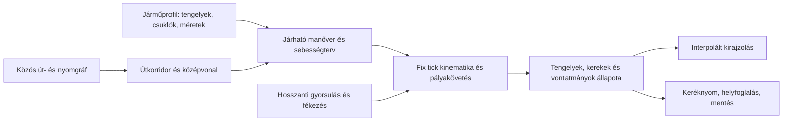

# Járműkinematika és szerkeszthető tengelygeometria

Megvalósított kinematikai alap és továbbfejlesztési követelmények, 2026-10-31. A tiszta .NET modell, a pályakövető, a mentett mechanikai állapot és az editor típusparaméterei már be vannak kötve. Az alábbi elméleti rész a modell alapját és a további követelményeket együtt dokumentálja.

## A bekötött változat

- `VehicleKinematics`: hátsó tengelyre vonatkoztatott kerékkormányzás, bal/jobb Ackermann-szög, aktív derékcsukló, passzív csuklólánc, külön kerékfordulat. SI-egységek; korlátos RK2-lépések; minden lépésben pontosan zárt csuklótávolság.
- `VehicleGeometryProfiles`: típusonkénti tengelycsoportok, darabszám, tengelyosztás, nyomtáv, keréksugár, kormányszög és kormányzási sebesség. Teherautónál szóló, egy passzív fokozatú vagy forgózsámolyos/vonórudas kialakítás. Processzornál kerék- vagy derékcsuklós kormányzás választható. Az alap processzorprofil a jelenlegi négykerekű, merev törzsű modellhez illeszkedik; a forwarder derékcsuklós.
- `RigPathFollower`: a gráf útvonalát kormányparanccsal követi; az előrehaladás az integrált referenciatengely helyzetének lokális vetülete. Tolatáskor a karosszéria nem fordul meg. A csuklós gép hátrameneti szabályozása a vezető hátsó vázrészt használja. Az aktív csukló szögsebességének átmeneti hatását is figyelembe veszi.
- A checkpoint az aktív geometriát, összes egység helyét és irányát, kerékfordulatokat, kormányszöget, sebességváltó-irányt és útvonalszárat is megőrzi. A teherautó munkafázisai között a mechanikai állapot továbbadódik.
- Editor: **Járművek → Tengelyelrendezés és kanyarodási próba**, majd a három típus geometriai paraméterei. Az előnézet a még nem alkalmazott értékekkel számol. A mezők a normál szabályprojekt és parancsnapló részei. A jármű a szolgálatba álláskor mintázza a profilt; menet közbeni szerkesztés nem alakítja át a mozgó szerelvényt. A gép a következő telephelyi induláskor kapja meg az új geometriát.

### Megőrzött játékméretek és egy sávos utak

A karosszériákat nem méretezzük át a fizikai tengelyadatokból. Az erdészeti gépek eredeti 0,42-es rajzolási skálája, illetve a teherautó eddigi, a sávszélesség 62%-ából számított egységes modellskálája marad. Tengelytáv vagy nyomtáv szerkesztése nem nyújtja meg a karosszéria meshét. A `RigVisualPose` a dioráma megjelenítési méretezésében, a szimulációból kapott szögekkel zárja a látható csuklókat; a fizikai SI-állapotot nem módosítja.

Minden út továbbra is egy sávos, közös középvonallal. A közelítőnyom vályútávolsága a kirajzolt forwarder-nyomtávból készül, beleértve az aktív gép mintázott profilját is. Ez közös referencia-vályúpár, nem minden korábbi jármű külön mentett talajlenyomata.

### A jelenlegi határ

A pályavizsgálat önálló síkbeli szerkesztőeszköz: 90°-os ív, két ellenkező 90°-os ívből álló S-kanyar és háromkörös állandósult próba választható. Az első kormányzott tengely / első bogiecsoport követi az előírt úttengelyt; a többi tengely és minden bal/jobb kerék külön integrált nyomvonalat kap. Az editor még nem alkalmazott típusparamétereit használja, és a kormány-/csuklószög vagy kormányzási sebesség határán diagnosztikával megáll.

A méteres rajz az összes tengely- és kerékpályát, úttengelyt, egy sáv két szegélyét, ívsugarakat és a szerelvény csúszkával kiválasztott helyzetét mutatja. A sugártáblában a belépés utáni helyi simulókör és az analitikus állandósult sugár külön oszlop: 90°-os ívben az átmeneti eltérés természetes. A nyerges és a forgózsámolyos kéttagú vontatmány hosszú körön a tankönyvi sugárhoz tart.

A söpört terület a szerkeszthető téglalap-karosszériakontúrok, kerekek és vonórudak mintái közti konvex burkolatok kitöltött uniója. A mintalépés általában 0,05 m, hosszú vizsgálatnál legfeljebb 10 000 lépésre korlátozott. Ez közelített, síkbeli vizsgálati burkolóterület, nem a játék meshének pontos vetülete vagy hatósági méretezés. A kontúrok/túlnyúlások kizárólag vizsgálati adatok; az exportált SVG a méreteket és az összes nyomvonalat is tartalmazza. A játékbeli modellek skálája változatlan.

### Folyamatos mozgás és terepi alátámasztás

A renderer csak a teljesen lezárt világ-tickben publikált mechanikai pillanatképekből interpolál (`RigPresentation`). Egy több képkockára bontott tick köztes járműmozgatása nem válik idő előtt láthatóvá. A mozgási alfa legfeljebb egy ticknyi előrejelzést enged, amíg a kooperatív munka elkészül; a megállt jármű nem extrapolálódik. A csuklók a kirajzolt köztes állapotokban is pontosan zártak. Ezek a megjelenítési pillanatképek nem változtatják meg a mentett szimulációs állapotot.

A kamion 3D testhelyzetét a tényleges vizuális tengelytáv és a terepi keréktámaszok adják. A vontató első/hátsó támasza meghatározza a bólintást, a bal/jobb támasz a dőlést. A pótkocsi az alvázon levő, magassággal rendelkező valódi nyeregponthoz csatlakozik; ettől a ponttól merev távolsággal keressük a hátsó keréktámaszt. Dombtetőn és völgyben ezért a vontató és a pótkocsi eltérően bólint, a kapcsolópont zárt marad, a testeket nem nyújtjuk. Ez geometriai alátámasztás, nem dinamikus rugózás vagy tehetetlenségi modell.

Ez síkbeli, kis sebességre szánt kinematika. A tandem tengelyek egyenértékű tengelycsoportot használnak; a gumi oldalcsúszása, rugózás és terhelésátrendeződés nem része az integrátornak. Az útfolyosó jelenleg a növényzettől építéskor megtisztított hálózati cella, nem a kirajzolt keskeny burkolat. A processzor munkaterületi ráfordulása ennél nagyobb manőverezési teret használhat. Teljes jármű-/rakomány-burkológörbe, épület- és faütközés, forgalmi helyfoglalás, valamint a keskeny burkolat automatikus szélesítése külön fejlesztés.

A csukló- vagy folyosóhatárnál a jármű a rakománnyal együtt megáll és jelez. A passzív szerelvény tolatási állapota fizikai, de általános, automatikus többpontos tolatási/megfordulási tervező még nincs. Emiatt minden topológiailag összekötött út nem válik automatikusan minden tetszőleges szerelvényprofil számára járhatóvá.


## A felváltott kirajzolási közelítés

A közös út- és közelítőnyom-gráf adja a topológiai útvonalat. A teherautó hosszanti gyorsulása, fékezése, menetellenállása és fogyasztása már szimulált. A korábbi kormányzás és vontatmánymozgás többnyire rajzolási közelítés volt:

- `VehicleRoadRoute.GetPose` a pálya két mintavételi pontjából számít testirányt.
- `VehicleRenderer.Articulation` a pálya korábbi pontjából becsüli az utánfutó tengelyének helyét.
- `VehicleVisualMotion.Steering` a görbületből rajzol kerékszöget.
- `ForestMachineRenderer.Articulation` rögzített csukló-/bogietávolságot használ, csak a forwardernél. A harvester nem kap önálló derékcsuklós kinematikát.
- A rakodáshoz és a megállókban a kirajzoló közvetlenül változtat helyet/irányt. Ez nem lehet a későbbi fizikai modell állapota.
- A teherautó oda-vissza útja jelenleg pingpong pályaparaméter. A menetirány megfordulását nem szabad a fizikai karosszéria és a vontatmány pillanatnyi 180°-os elfordításaként értelmezni.

A pálya korábbi pontját követő utánfutó nem helyettesíti a vontatmány mozgásegyenletét. Kanyarban a vontatmány beljebb vág; a csuklópontot és a merev távolságokat meg kell tartani.

## Három külön járműcsalád

| Család | Kormányzott szabadságfok | Referenciapont | Hátsó egység |
| --- | --- | --- | --- |
| Merev teherautó / nyerges vontató | kormányzott tengelyek, Ackermann-geometria | a nem kormányzott hátsó tengelycsoport közepe | opcionális passzív vontatmány |
| Forwarder | aktív derékcsukló | az első bogiecsoport közepe | a saját hátsó vázrésze, nem passzív utánfutó |
| Kerekes harvester / processzor | típus szerint kerékkormányzás vagy aktív derékcsukló | hátsó tengely, illetve első bogiecsoport | merev törzs vagy külön hátsó vázrész |

Gyártói példák, nem minden gépre érvényes állandók: a John Deere 1910G forwarder adatlapja 42° kormányzási szöget és külön csukló–bogie méreteket ad meg; a 1270G harvester arányos vázkormányzást, ±44° szöget és bogie-/tengelykialakítást ír le. Ezek a típusonként szerkeszthető geometria szükségességét támasztják alá. [1910G gyártói adatlap](https://www.deere.com/assets/pdfs/common/products/forwarders/MFO1910GF-1910G-forwarder.pdf), [1270G gyártói adatlap](https://www.deere.com/assets/pdfs/common/products/wheeled-harvesters/mwh1270gf-1270g-wheeled-harvester.pdf)

## Egységek és feltételezések

Az első modell kis sebességű, síkbeli kinematika. Nincs oldalcsúszás, rugózott tömegmodell vagy gumierő-szimuláció. A meglévő hosszanti járműdinamika továbbra is a sebességet számítja. A talaj magasságát a kiszámított tengelypontok alatt külön mintavételezzük a bólintás és az oldaldőlés megjelenítéséhez.

A szimuláció métert, másodpercet és radiánt használ. Az editor fokban kér szögeket. A testkoordináta +X előre, +Y balra, +Z felfelé. A GLB méretezése és a dioráma kirajzolási skálája külön transzformáció; az út szélességéhez igazított mesh-skála nem változtathatja meg a fizikai tengelytávot.

Tandem/tridem vagy bogie több, egymástól eltérő hosszhelyzetű fix tengelyének tökéletes csúszásmentessége kanyarban egyszerre nem teljesíthető. Az első modell egy súlyozott ekvivalens tengelycsoporttal számol; a tényleges keréksorok helye, fordulata és a befoglalt terület külön szerepel. Ez tudatos, kis sebességű közelítés.

## Egyenletek

### Teherautó: kerékpármodell és kerekenkénti szög

A hátsó ekvivalens tengely középpontja `p=(x,y)`, a test iránya `theta`, az előjeles sebesség `v`, a tengelytáv `L`, az ekvivalens első kormányszög `delta`:

```text
x_dot     = v cos(theta)
y_dot     = v sin(theta)
theta_dot = v tan(delta) / L
kappa     = tan(delta) / L
R_min     = L / tan(delta_max)
```

Ez a kis sebességű kerékpármodell hátsó tengelyre helyezett állapotdefiníciója. [MathWorks bicycleKinematics](https://www.mathworks.com/help/nav/ref/bicyclekinematics.html)

A referencia-tengelyhez képest `(x_i,y_i)` helyen lévő kerékhez, `omega=theta_dot` mellett:

```text
u_i     = v - omega y_i
w_i     = omega x_i
delta_i = wrap_to_half_pi(atan2(w_i, u_i)) # keréksík modulo pi, hátramenetben sem fordul 180°-ot
speed_i = u_i cos(delta_i) + w_i sin(delta_i)
roll_i_dot = speed_i / radius_i
```

Előremenetben a kormányzott első tengely bal/jobb kereke eltérő szöget kap: `atan2(kappa L, 1-kappa y_i)`. A fix hátsó kerék nem kap hamis vizuális kormányzást. A hátsó kormányzás külön tengelyüzemmód és arány legyen, ne automatikusan az első tengely másolata.

Hátsó kormányzásnál a referenciapont oldalirányú sebessége sem nulla. Két ekvivalens kormányzott tengelyre, `v_x` testirányú sebességgel:

```text
v_y = v_x tan(delta_rear)
omega = v_x (tan(delta_front) - tan(delta_rear)) / L
x_dot = v_x cos(theta) - v_y sin(theta)
y_dot = v_x sin(theta) + v_y cos(theta)
```

A kerekenkénti képletben ekkor `w_i = v_y + omega x_i`. Azonos első/hátsó szögnél rákjárás adódik, ellenkező szögnél kisebb fordulókör. Tetszőleges, egymással ellentmondó fix tengely- és kormányszög-beállítás nem teljesíthető csúszás nélkül; a profil validálása és az ekvivalens tengelycsoportok ezt kezelik. Ez a kerékpármodell kényszereinek saját általánosítása.

### Passzív utánfutó: a vonópont sebességéből

Legyen `e(theta)=(cos(theta),sin(theta))`, `n(theta)=(-sin(theta),cos(theta))`. A vontató referencia-tengelyéhez képest a vonópont helye `(h_x,h_y)`:

```text
H   = p + h_x e(theta) + h_y n(theta)
V_H = (v - omega h_y)e(theta) + omega h_x n(theta)
```

Az utánfutó iránya `psi`, a vonópont–ekvivalens tengely távolság `l`:

```text
psi_dot = dot(V_H, n(psi)) / l
v_trailer = dot(V_H, e(psi))
A = H - l e(psi)
```

Az `A` tengelypontot a csuklókényszerből számítjuk, így a vonórúd hossza nem sodródik el a numerikus integrálásban. Több passzív egységnél a következő egység a megelőző egység saját vonópontjának sebességét kapja. A félpótkocsi és a dolly/forgózsámolyos teljes pótkocsi eltérő egységlánc. Az off-axle vonópontot nem lehet minden esetben a vontató hátsó tengelyére egyszerűsíteni. [Linköping: general two-trailer kinematics, 2.18–2.20 egyenletek](https://liu.diva-portal.org/smash/get/diva2%3A1279885/FULLTEXT01.pdf)

Ellenőrizhető példa: a vonópont a vontató hátsó tengelyén, állandó `R=20 m` kör, `l=8 m`. Állandósult állapotban az utánfutó tengelyének sugara `sqrt(R²-l²)=18,33 m`, tehát körülbelül 1,67 m-rel beljebb halad. A vontató korábbi nyomvonalának másolása ezt nem adja vissza.

### Derékcsuklós forwarder és harvester

A front iránya `theta_f`, a rear iránya `theta_r`, a vezérelt csuklószög `alpha=theta_f-theta_r`. A csuklótól az első ekvivalens tengelyig `l_f`, a hátsóig `l_r` a távolság. Az első tengely előjeles sebessége `v_f`:

```text
theta_f_dot = (v_f sin(alpha) + l_r alpha_dot) / (l_r + l_f cos(alpha))
theta_r_dot = theta_f_dot - alpha_dot
J = p_f - l_f e(theta_f)
p_r = J - l_r e(theta_r)
```

Ez a csúszásmentes csuklósebesség-kényszerből levezetett modelljavaslat. A csuklószög változási sebessége is számít: a hátsó váz nem kezelhető egy hosszú, passzív pótkocsiként. Állandó csuklószögnél az első tengely görbülete `sin(alpha)/(l_r+l_f cos(alpha))`. A számított csuklószögre és szögsebességre külön korlát kell. A harvester daru-/fülkeforgása és a váz talajkövető billenése ettől független szabadságfok.

## Útvonal, pálya és járműállapot szétválasztása



Az út középvonala infrastruktúra-adat. A jármű kormányozhatósága a megengedett referencia-tengelypályát és a szükséges helyet határozza meg. Nem írjuk át járművenként az úthálózat topológiáját.

A pályakövető a kijelölt referenciapontot vezeti, például a teherautó hátsó tengelycsoportját vagy a forwarder első bogiecsoportját. A többi tengely és test mozgását a kinematika adja. A kirajzoló nem helyezhet el külön, egy régebbi útpontból becsült utánfutót.

A fordulósugár-korlátot meghaladó ívet nem javítja meg a kerékszög levágása. Ilyenkor nagyobb ívet kell tervezni a rendelkezésre álló korridorban, más útvonalat választani, vagy megállni egy egyértelmű „nem fér el / túl szűk kanyar” állapottal. A lassítás a kinematikailag lehetetlen kanyart nem teszi lehetővé.

## A teljes profil tervezett adatköre

`Járművek → Geometria és kormányzás`, külön profil a teherautóhoz, forwarderhez és processzorhoz:

| Adatcsoport | Mezők |
| --- | --- |
| Járműcsalád | merev/Ackermann, derékcsuklós, opcionális passzív egységlánc |
| Tengelyek | stabil ID, vázrész, hosszirányú hely, nyomtáv, keréksugár, fix/kormányzott/bogie, ekvivalens csoport |
| Kormányzás | legnagyobb szög, legnagyobb szögsebesség; több kormányzott tengelynél arány/üzemmód |
| Csuklók | pozíció az előző vázrészhez képest, aktív/passzív jelleg, csuklószög-korlát |
| Vontatmány | kapcsolási pont, kapcsolási pont–tengelycsoport távolság, saját tengelyek és befoglaló méret |
| Testek | szélesség, első/hátsó túlnyúlás, ekvivalens tengely és mesh-origó kapcsolata |
| Modellkötés | a vázrészek és kerékcsomópontok GLB-beli azonosítói; a fizikai adatok nem a node-nevekből származnak |

A profilt az alkalmazás előtt validáljuk: pozitív távolságok és sugarak, véges számok, egyedi azonosítók, helyes egységsorrend, érvényes tengely-/vázkötések, nem szinguláris csuklógeometria. A mozgó jármű mechanikai mérete nem változhat meg egy frame közepén; a geometriafrissítés telephelyen/álló állapotban lép életbe, a futó gép addig a rögzített aktív profilját őrzi.

A nézetben legyen felülnézeti geometria, referencia-tengely, vonópontok, számított minimális sugár, kör/90°/S-ív próba, kerekenkénti nyomvonal és a teljes szerelvény söpört területe. A túl szűk próba ne szép, de fizikailag lehetetlen animációval záruljon.

## Integrálás, mentés és visszafordulás

- A kinematika a szimuláció tulajdonosa; a renderer csak interpolál. Állapot: pozíciók, testirányok, tényleges kormányszög/csuklószög, kerekenkénti gördülési szög, menetirány, pályakurzor és aktív profil teljes paraméterkészlete.
- Determinisztikus fix tick és korlátos belső út-/szöglépések szükségesek. Nulla sebességnél nem sodródhatnak a vontatmányok. RK2/midpoint integrálás jó első közelítés; a merev csuklótávolságot minden lépésben pontosan visszaállítjuk.
- A vontatmány iránya és a kormányszög mentési állapot, nem frame-cache. Mentés után a szerelvény nem egyenesedhet ki.
- Az előre-/hátramenet előjeles sebesség, nem a karosszéria irányának pillanatnyi megfordítása. Végponton megtervezett megfordulás vagy külön tolatási manőver kell. Több pótkocsi tolatásához önálló szabályozó és becsuklásvédelem szükséges; ezt nem szabad az első változatban automatikusan megoldottnak tekinteni.
- Új útvonalra váltás a meglevő mechanikai állapotból indul. A topológiai kerülőút nem jogosít fel a csuklószögek vagy a járműhelyzet törlésére.

## A teljes továbbfejlesztés elfogadási feltételei

1. Tiszta .NET kinematikai mag és verziózott profiladatok: Ackermann, aktív derékcsukló, passzív vontatmánylánc. Tesztek: egyenes, kör, tükörszimmetria, vonórúdhossz, zéró sebesség és integrálási lépés finomítása.
2. Editor-geometria és pályapróba. JSON-roundtrip, hibás geometria elutasítása, típusonkénti függetlenség és GLB-kötés validálása.
3. Runtime-állapot és checkpoint. A menet közbeni mentés és eltérő munkabüdzsével folytatás ugyanazt az összes tengely- és vontatmányállapotot adja.
4. Pályakövetés és geometriai járhatóság. Megengedett sugarak, söpört terület, útmegszakadás és visszafordulóhely; nincs sarokvágás épületen/fán keresztül, nincs végponti teleport.
5. Kirajzolás a közös fizikai állapotból. Kerekenként külön kormányszög/gördülés; a forwarder és a harvester vázrészei, valamint a teherautó vontatmánya ugyanazokat a csuklóállapotokat használják, amelyeket a szimuláció és a helyfoglalás.

Az útkeresési/faanyag-szállítási javítások ettől függetlenül tesztelhetők és megtarthatók. A kinematikai átállás akkor tekinthető késznek, ha az editorérték nemcsak a kerék animációját, hanem a kiszámított tengelypályát és a járhatósági döntést is megváltoztatja.


## Numerikus modellpróba

A kutatási munkapélda külön Python/RK2 számítással ellenőrzi a passzív vontatmány körpályáját. `R=20 m`, `l=8 m`, `ds=0,02 m` mellett az állandósult numerikus sugár 18,330302780 m, az analitikus értékkel 0,0001 m-en belül egyezik. A csukló–tengely távolság megőrzése a konstrukcióból adódik; a számolt legnagyobb lebegőpontos eltérés 1,8e-15 m. Ez matematikai munkapélda, nem a játékban futó új járműmodell.

Egy szemléltető derékcsuklós geometria (`l_f=2,2 m`, `l_r=4,8 m`, `alpha=42°`) az első bogiecsoportnak 9,616835 m-es, a hátsónak 8,618788 m-es körsugarat ad. Ezek a szemléltető profil számai, nem egy gyártói gép pontos méretei. A két család különböző tengelypályát adó egyenletei numerikusan is megkülönböztethetők.

## Ellenőrzés a magyar erdészeti úttervezési tankönyvben

Forrás: Kosztka Miklós, Markó Gergely, Péterfalvi József, Primusz Péter: **Erdészeti utak tervezése, építése, fenntartása**. A [Soproni Tananyag Archívum példánya](https://tananyag.uni-sopron.hu/30/1/erdeszeti_utak_tervezese_epitese_fenntartasa.pdf) 582 PDF-oldalas összeállítás. Ez a hozzáférhető közös tananyag; nem állítjuk, hogy a külön kiadott, 2012-es *Erdészeti útépítés – Erdészeti utak tervezése* kötettel azonos kiadás.

A tervezési rész nyomtatott 92–99. oldala (PDF 94–101) tárgyalja a következőket:

- Merev tehergépkocsi; vonórudas pótkocsi; egyszerű és kormányzott hosszúfás utánfutó; nyerges félpótkocsi; alvázcsuklós vontató és forwarder.
- A tehergépkocsinál `a1` a tengelytáv, `a2` a hátsó tengely–vonóhorog távolság, `a3` a vonórúd hossza, `a4` a pótkocsi tengelytávja. A fronttengely `R1` körpályája mellett a hátsó tengely sugara: `R5 = sqrt(R1² − a1² + a2² − a3² − a4²)`. A pontos állandósult szélesítési igény `R1 − R5`.
- A középen csuklózott vontató és az aszimmetrikus forwarder eltérő nyomot követ. A kormányzott hosszúfás szerelvénynél a rakomány kilógását is vizsgálni kell.
- Az útfenntartási rész 2.1. ábrája, nyomtatott 33. oldal (PDF 493): TGK SS, TGK ST, PK S, PK SS, PK T. Az S egyszerű tengely, a T tandem tengelycsoport. A tengelycsoport és a kormányzási rendszer külön adat.

### A motorban ebből következő döntések

A fenti képletet külön analitikus ellenőrzésként használjuk (`ForestRoadSweptPath`), nem az átmeneti mozgás integrátoraként. A numerikus modellnek hosszú körpályán ehhez kell közelítenie. S-kanyarban, be- és kihaladáskor, illetve tolatáskor a teljes csuklólánc állapotát integráljuk.

A két tengelyes vonórudas pótkocsi két passzív csuklós fokozat: elöl a vonórúd és forgózsámoly, utána a pótkocsi tengelytávja. A nyerges félpótkocsi egy passzív fokozat. A tandem kerekek külön kerékpozíciót és fordulatot kapnak, de egyenértékű tengelycsoportjuk adja a síkbeli gördülési kényszert. A hajtott tengelyek száma önmagában nem kormányzási mód.
